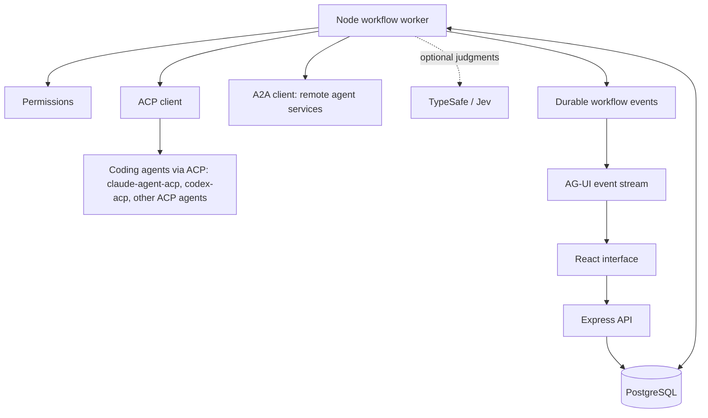

# Spark Outpost — product and implementation plan

Date: 2026-09-24, revised 2026-09-25 (protocol stack, database portability, desktop shell, mockup alignment) and 2026-10-10 (one agent session per chat; Spark's own coordinator, specialists, reviewer and checks are removed, see [SIMPLE_ORCHESTRATION.md](../architecture/SIMPLE_ORCHESTRATION.md))
Working tagline: A home base for autonomous work.

## 1. Product

Spark Outpost is a local-first workspace where people give a goal to an AI agent, follow meaningful progress, make decisions when needed, and receive results with the agent's own evidence.

The application owns run state, approvals, worktrees and publishing. The agent owns the work: it plans, delegates and checks as it sees fit. Providers supply intelligence and execution capabilities. A conversation is a durable user record; a provider session is one replaceable execution resource within it.

Start with repository-based software tasks because changes, tests, and independent review provide concrete acceptance criteria. Keep the product direction broader than coding, but add other workflows only when there is a real caller.

Dhago remains a separate product. Reuse verified lessons and selected code only after checking dependencies and licensing; do not copy its entire terminal, daemon, or UI architecture into this product.

## 2. Decisions and open choices

| Topic                          | Decision                                                                                                                                                                                                                                  |
| ------------------------------ | ----------------------------------------------------------------------------------------------------------------------------------------------------------------------------------------------------------------------------------------- |
| Name                           | Spark Outpost; repository name `spark-outpost`                                                                                                                                                                                            |
| Domain                         | `sparkoutpost.com` appeared unregistered during the naming check; purchase and trademark clearance are not done                                                                                                                           |
| Delivery                       | Local-first now; cloud hosting later                                                                                                                                                                                                      |
| Backend                        | Node.js, Express, TypeScript                                                                                                                                                                                                              |
| Frontend                       | React, Vite, TypeScript                                                                                                                                                                                                                   |
| Repository                     | pnpm workspace monorepo                                                                                                                                                                                                                   |
| Database                       | PostgreSQL everywhere: a native Homebrew cluster in the repository's `.local` folder in development, an embedded Postgres binary in the desktop app, RDS or Aurora PostgreSQL in the cloud. Versioned plain-SQL migrations. See section 7 |
| UI state                       | React state for ephemeral UI; TanStack Query for API data                                                                                                                                                                                 |
| Long lists                     | TanStack Virtual where transcript/activity volume warrants it                                                                                                                                                                             |
| Coding agents (provider layer) | ACP (Agent Client Protocol) over stdio, using `@agentclientprotocol/sdk`. Claude through `claude-agent-acp`, Codex through `codex-acp`. A native-SDK adapter only where ACP cannot cover a required capability                            |
| Agent interface (server to UI) | AG-UI 1.0 events over SSE, replayed from a saved cursor. `@ag-ui/core`, `@ag-ui/client`, `@ag-ui/encoder` (MIT)                                                                                                                           |
| Agent collaboration            | A2A 1.0 via `@a2a-js/sdk`: outpost chats on loopback today, independent remote agents from phase 3                                                                                                                                        |
| CopilotKit                     | Not adopted for phases 0–1. Its prebuilt UI does not fit the mockup, and its runtime expects to own runs. Re-evaluate the headless v2 hooks after phase 1                                                                                 |
| Decision assistance            | Optional TypeSafe/Jev for bounded typed judgments                                                                                                                                                                                         |
| Desktop packaging              | Electron (preferred), as a thin shell around the unchanged web app and Node service. Decide after the web milestone                                                                                                                       |
| Cloud hosting                  | Later: API and worker on AWS containers, RDS or Aurora PostgreSQL, S3 for artifacts. A hybrid mode with a local runner is the likely first step                                                                                           |
| Rust backend                   | Deferred                                                                                                                                                                                                                                  |

Chat providers connect through ACP adapters maintained by third parties (Zed and the ACP project), so verify which ACP messages each adapter actually sends before relying on them. Separately, users can choose a Terminal session with the installed Claude Code or Codex interactive CLI. It receives Spark tools and task context, with native permissions and a Spark-owned process lifecycle; it does not start the Chat crew. Chat and Terminal are separate session types. The persistent desktop runtime and recovery behavior are described in [native Terminal sessions](../architecture/NATIVE_TERMINALS.md).

Provider authentication methods, terms, model options, and supported capabilities must be verified before integration; do not assume a consumer subscription grants API or third-party product access. Use an API key or the user's existing local CLI login, not an in-app provider account sign-in.

## 3. First user journey

1. Open the app, connect an available provider, and choose a project or a standalone conversation.
2. Enter a goal, desired outcome, and any permission limits.
3. The message goes to the chat's agent as typed. The agent asks what it needs, plans when asked to (`/plan` or its Plan mode), and decides whether to use its own sub-agents or propose sub-chats in an outpost, which the user starts.
4. The agent executes permitted work in the chat's worktree. Every tool call, a sub-agent's included, passes the same approval gate and audit.
5. The conversation streams useful text and activity summaries. The user can inspect details, queue or send a message, cancel, or respond to an approval request.
6. The agent runs the project's checks itself. Spark runs none; the repository's hooks and CI run on a push. A second opinion is another chat the user asks.
7. Changed files are kept with a record that can be reverted. At Full auto → PR, on request or in a follow-up round, Spark sends the agent one publish prompt.
8. The user receives the result, changed files, what the agent verified or skipped, and any publication result.

All conversations pass the same boundary for policy and persistence. No message invokes a planner, specialist team, or reviewer of Spark's own.

Implementation gates and current protocol status: [Protocol alignment](../architecture/PROTOCOL_ALIGNMENT.md).

## 4. Architecture and ownership



The API validates requests, saves commands, reads projections, and streams events. The worker owns execution independently of the browser connection. Use the same Node codebase with API and worker entry points; introduce no distributed infrastructure before it is needed.

PostgreSQL is the source of truth for conversations, workflow progress, approvals, and execution receipts. The browser cache is a view of that state. Reconnecting a browser does not start a second workflow.

### Protocol layers

Each protocol has one job. None of them supplies our scheduler, permissions, durable queue, or independent review policy.

| Layer                  | Protocol       | Role                                                                                                                                                            |
| ---------------------- | -------------- | --------------------------------------------------------------------------------------------------------------------------------------------------------------- |
| Worker ↔ coding agents | ACP over stdio | Detailed local control: streamed text, reasoning, tool calls, diffs, terminals, plans, permission requests, session config options, usage, cancel, session load |
| Worker ↔ remote agents | A2A            | Opaque agents we do not control. We show only what they report: task status, messages, artifacts                                                                |
| Server ↔ UI            | AG-UI          | One event format to the browser, whichever path the work came through                                                                                           |
| Tools                  | MCP            | Only when a concrete integration needs it                                                                                                                       |

The application stays provider-agnostic through our own contract in `packages/contracts` (capability snapshots, normalized events, approvals, receipts), not through any one wire protocol. ACP messages convert to AG-UI events almost one-to-one; A2A task updates convert to `SUBAGENT_*` and `ACTIVITY_*` events.

A2A is used between outpost chats, not inside a chat. Delegation inside a chat belongs to the agent (its own sub-agents); delegation across chats is proposed by the agent as a draft and started by the user. Do not use `@ag-ui/a2a-middleware`: it exposes A2A calls as a tool the model may call by itself, which would let a model start work in another chat without the user.

ACP limits to plan around:

- The HTTP and WebSocket transport is still a proposal. Local stdio is stable; for hosting, run adapters beside the worker.
- `session/request_permission` is a blocking request. The worker keeps the agent process alive while an approval waits. If the worker crashes during the wait, record the outcome as unknown and restore with `session/load`.
- The Claude and Codex adapters are third-party. Features can lag, and optional messages such as `usage_update` may be missing.

### Two streams to the UI

- Per-run AG-UI stream for the open chat, replayed from a saved cursor. The browser-side agent implements AG-UI `connect()` for reconnects; the default `HttpAgent` does not.
- App-wide status stream with each chat's current status, from a Postgres projection. It drives the sidebar rows, Home, the rail badge, the Blob Scout mood, and the favicon. AG-UI covers one run at a time, so this stream is our own.

Use a single local worker initially. Every chat's turn starts as soon as it is sent, with no limit on concurrent runs; turns within one chat run in order through the chat's queue. Use a small PostgreSQL-backed job queue with transactional claiming (`FOR UPDATE SKIP LOCKED`), lease expiry, and attempt records. Handwrite it or adopt `graphile-worker` or `pg-boss` (both MIT, Postgres-only); decide during bootstrap. Do not add Redis, Kubernetes, or a general workflow engine in the first milestone.

### User-visible A2A collaboration

Show real delegation messages, task updates, and shared artifacts in a compact collaboration timeline. Let users expand handoffs to inspect requests, authorized context, and responses. Clearly distinguish summaries from original messages. Remote private activity is unavailable unless reported.

Provide an Agents connection screen for user-supplied endpoints, verified Agent Cards, authentication, and per-workflow sharing scope. Agent Card capabilities are self-reported and do not imply trust. Spark serves each outpost chat as an A2A agent on loopback only, behind the launch token, never to a paired phone or through Tailscale ([A2A_CHATS.md](../architecture/A2A_CHATS.md)). A remote endpoint remains deferred and must be opt-in with authentication and scoped access.

## 5. What Spark does in a turn

- Place: one worktree and `spark/*` branch per chat, created on the first turn in a mode that can change files.
- Execution: one run on the chat's own session. The prompt is the user's message. Spark authorizes each tool call through the approval gate and collects events, the audit and usage.
- Planning: the agent's own. `/plan` and a Plan-mode chat start the turn in the agent's plan mode; a plan the user approves is saved as the chat's agreed plan.
- Result: changed files are kept with a record that can be reverted; a ticket named in the user's text is linked.
- Publishing: one publish prompt to the same session when the publish rules give a reason and the chat's branch has unpublished work.
- Completion: provider-reported success and human acceptance are kept distinct. Spark makes no verification claim of its own.

Run states are queued, running, awaiting input, awaiting approval, succeeded, failed, cancelled, and outcome unknown. A provider transport error is not automatically user cancellation.

Bind events and decisions to run and revision identities. Ignore stale decisions after cancellation or revised instructions. There are no retry, time, tool-call or cost limits: usage is measured and shown, exact only to the extent providers expose it; show unavailable or delayed usage honestly.

For code tasks, each chat writes in its own worktree, so chats never overwrite each other's files. Inside one session the agent owns what its sub-agents change.

## 6. Human control

Normal operation is human-on-the-loop: agents work within the user's chosen scope while the user observes, steers, or stops them.

Use human-in-the-loop checkpoints for missing requirements and actions that require authorization under the selected policy. Present the proposed action, target, important consequence, and clear allow/deny choices. Preserve the provider's actual permission semantics.

Map ACP `session/request_permission` options (`allow_once`, `allow_always`, `reject_once`, `reject_always`) onto the approval card without renaming their meaning. An "always" choice becomes a stored, scoped, revocable rule in our database, not only in the agent. Missing requirements use the AG-UI interrupt outcome; answers resume the run.

The backend enforces approval. Bind approval to the specific action and current revision; edits to an action require renewed authorization when outside the approved scope. Model output, Jev confidence, and cached UI settings never grant permission by themselves.

External publication such as merge, deploy, sending messages, or spending money follows explicit user authorization. Already authorized routine work should continue without repetitive confirmation.

## 7. Durability and recovery

Persist projects, conversations, messages, runs, steps, attempts, events, approvals, artifact references, provider-session mappings, capability snapshots, and usage records. Keep large binary artifacts on disk initially, with validated references and content hashes in PostgreSQL.

Use append-only execution events with monotonic sequence numbers and ordinary queryable state projections. Write state changes and their events transactionally. Stream from a saved cursor, deduplicate replays, and provide a snapshot if a cursor is older than retained events.

Lease claims need fencing or equivalent attempt/revision checks so a stalled worker cannot continue committing results after a replacement worker takes over. Cancellation stops scheduling new work and requests termination of the active provider operation; mark terminal cancellation only after observing the outcome or explicitly recording uncertainty.

The system must not blindly retry an external side effect when a crash obscures whether it completed. Reconcile receipts, provider operation IDs, and artifact state first. Use idempotency keys where supported. Escalate uncertain non-idempotent operations rather than promising universal exactly-once execution.

Closing the interface leaves the local service running when background execution is enabled. Stopping the service preserves resumable state. Computer sleep, shutdown, or network loss can interrupt work; local-first does not mean execution continues while the computer is off.

Keep user history and drafts if a provider session disappears. Explain the recovery path and prepare bounded context for a replacement session. Never imply that a replacement session remembers everything the old provider session did.

### Database portability

The same PostgreSQL schema and migrations run in development, in the desktop app, and in the cloud. Choices made from phase 0 so the cloud move stays a configuration change:

- Plain SQL migrations committed to the repository. A typed query builder (Drizzle or Kysely) is fine; nothing local-only.
- Application-generated UUIDv7 identifiers and `timestamptz` throughout.
- A `workspace_id` on top-level tables from the start, so accounts can be added without a large migration.
- Large files behind a small storage interface: local disk now, S3 later. PostgreSQL keeps references and content hashes.
- No secrets in PostgreSQL: the OS keychain locally, AWS Secrets Manager or KMS in the cloud.
- Only the worker writes execution events and claims jobs; API instances read and stream. This lets API and workers scale separately.
- `LISTEN/NOTIFY` wakes event streams. It does not work through RDS Proxy or PgBouncer in transaction-pooling mode, so listeners use a direct connection or fall back to short-interval polling.
- Track the growth of the events table; partition or archive with snapshots when retention requires it.

Do not run SQLite locally and PostgreSQL in the cloud; two dialects and two queue behaviors double the testing.

## 8. Provider capability caching and frontend state

Separate three things: reusable provider metadata, effective session settings, and current execution readiness.

- On app start, hydrate validated persisted capability snapshots and refresh them in the background.
- Cache metadata by provider identity, account/profile, adapter version, and any configuration or workspace scope that changes its meaning.
- Share in-flight discovery requests. Opening a conversation must not trigger a fresh global discovery operation or discard existing controls.
- Show cached model, reasoning, and supported option choices immediately when a valid snapshot exists. Keep controls mounted during refresh.
- A truly first-time provider with no snapshot may require discovery; show that once honestly rather than inventing models or permissions.
- Apply session-specific settings only after reconciling them with the live provider. Preserve pending user choices while the session initializes; never display them as already effective if they are not.
- Refresh on relevant settings/account/adapter changes and controlled background intervals. Surface actionable failures without replacing the whole composer.
- New adapters implement the same capability snapshot and invalidation contract. Shared UI has no provider-name branches for ordinary option rendering.
- For ACP agents, the snapshot is built from session config options (categories `model`, `thought_level`, `mode`), which map to the composer's model, effort, and permission controls. Change them with `session/set_config_option` and accept `config_option_update` as the effective state. Ignore the older session modes API where config options are present.

TanStack Query owns API cache lifecycle, deduplication, and background revalidation. React owns input drafts, panel state, and local interactions. AG-UI events feed one normalized run projection and invalidate or update relevant query entries; avoid competing event and query stores for the same field. Persist nonsecret metadata deliberately; in-memory Query state alone does not survive restarting the app.

Backend authentication and execution authorization are always authoritative. A cached connection result is a display optimization, not proof that a new action can run.

## 9. Context, compaction, and cost

Maintain three distinct concepts: saved conversation history, the context actually supplied to an agent, and model/provider prompt caching.

History pagination and virtualization keep the interface responsive; neither reduces the model's context by itself. TanStack Query caches application responses; it does not provide LLM prompt caching.

For each agent, display provider-reported context tokens and capacity when available, with timestamp and source. For ACP agents the source is `usage_update` (`used`, `size`, optional cost) where the adapter sends it. If only an estimate is available, label it. Never show an empty ring as if unknown usage meant zero. Do not add independent agents' occupancy into a fictitious shared context window.

Preserve user goals, constraints, approvals, decisions, current plan, artifact references, unresolved findings, and resume information in a versioned context checkpoint. Summarize repetitive logs and retrieve details on demand. Keep original history and evidence available; compaction is not silent deletion.

Use provider-native compaction only when supported. Our checkpoint remains separate from opaque provider session state. Verify the current provider/ACP contract before exposing a manual compact action.

Where supported, improve prompt-cache reuse with stable prefixes, deterministic context ordering, and provider-native cache mechanisms. Do not promise savings for opaque CLI sessions. Record cache usage and cost only when actually reported. Bound repeated delegation, retries, and context fan-out before adding optimization services.

## 10. Jev's optional role

Use code for exact rules and permissions. Jev is not called inside a turn. It is used for bounded semantic choices outside turns: labelling Map areas, sorting pull request feedback, and the companion's updates, each with rules as the fallback.

Retrieve a bounded candidate set first. Validate returned IDs and reject stale answers. Use a no-match or escalation path. A generative provider writes plans, explanations, and final responses; Jev supplies typed judgments.

Begin with deterministic behavior and an explicit provider selection. Evaluate an optional Jev decision in observation mode against representative examples before allowing it to affect anything. Measure quality, latency, and cost. Failure or absence of Jev must not prevent normal operation.

## 11. Interface requirements

The main workspace combines a project/conversation sidebar, a conversation and activity area, a composer, and an optional context/files/review panel. Preserve mounted views, theme, focus, selection, scroll position, and popover anchors.

- Apply the saved theme before first paint; match loading and desktop window backgrounds to avoid a white flash.
- List project conversations first, then standalone conversations below a divider without a forced Projectless folder.
- Adding a project starts a conversation in it. Removing its sidebar registration preserves conversations and local files; retain provenance independently of an optional grouping link. Handle active runs explicitly without deleting their workspace.
- Show local and remote branches in a compact picker. Block checkout changes while a run or uncommitted changes make switching unsafe; explain the reason.
- Keep Context, Files, and Review actions near the title. Add a user terminal only when the first workflow requires it; provider tools are not user terminal sessions.
- Make side panels resizable with subtle boundaries and resize cursors. Persist widths after gestures rather than per frame.
- Group activity with its originating turn. Keep status, count, and updated time together; align it with the response and avoid large gaps or decorative activity rails.
- Stream actual provider text as available. Surface meaningful tool/progress events beneath the active turn, retain details in expandable history, and remove only temporary previews at completion.
- Do not fabricate streaming with a typewriter effect when a provider delivers only a final result. Identify that provider limitation.
- Prefer structured event rules for progress selection initially; do not make an AI call for every activity or token.
- Use compact, accessible permission cards. Avoid duplicate status messages and raw JSON as the default presentation.
- Use accessible, themed provider controls, tooltips, visible option labels, reduced-motion animations, and honest capability availability.
- Make copy actions easy. Treat automatic copy-on-selection as an optional preference so normal selection does not unexpectedly replace the clipboard.

### Mockup alignment

The design kit (`docs/design/mockup/spark-outpost-mockup.html`, `docs/design/ux/spark-outpost-ux-flow.md`) defines the visual language and most chat interactions. Event sources for its run states:

| Mockup                         | Source event                                                                                             |
| ------------------------------ | -------------------------------------------------------------------------------------------------------- |
| Starting                       | AG-UI `RUN_STARTED`                                                                                      |
| Working log, "Step n of m"     | ACP `tool_call` / `tool_call_update` and `plan` → AG-UI `STEP_*` or `ACTIVITY_*`                         |
| "Thought through the approach" | ACP `agent_thought_chunk` → AG-UI `REASONING_*`                                                          |
| Streamed reply                 | ACP `agent_message_chunk` → AG-UI `TEXT_MESSAGE_*`                                                       |
| Diff card, test result         | ACP tool call content `diff` and `terminal` → AG-UI `TOOL_CALL_*` and `TOOL_CALL_RESULT`                 |
| Approval card, Asking          | ACP `session/request_permission` or `elicitation/create` → AG-UI `RUN_FINISHED` with outcome `interrupt` |
| Stopped                        | ACP `session/cancel` → AG-UI `RUN_FINISHED` with outcome `cancelled`                                     |
| Error                          | AG-UI `RUN_ERROR`                                                                                        |
| Context ring                   | ACP `usage_update` → AG-UI `CUSTOM`                                                                      |
| Next-action pills              | AG-UI `CUSTOM` (ours)                                                                                    |
| Delegated agents               | A2A task updates → AG-UI `SUBAGENT_*`                                                                    |

Needs design before its phase (in this plan, missing from the mockup):

- Approval card during a run (phase 1).
- Review panel and evidence levels: provider reported, checks passed, independent review, human acceptance (phase 3).
- Context, Files, and Review actions near the title; branch picker with its unsafe-to-switch state.
- More than one agent in a turn; the mockup assumes one provider mascot per chat (phase 3).
- Agents connection screen and collaboration timeline for A2A (phase 3).
- Goal and permission limits at intake; outcome-unknown and recovery states.

Tickets and the Jira/Linear/GitHub connectors, shown deferred in the mockup, are now built (`apps/web/src/tickets/`). Home depends on the app-wide status stream.

Mockup behaviors this plan overrides:

- "Sign in with Claude" and "Sign in with ChatGPT": not in v1 until the provider terms allow third-party apps to offer them. Ship Local CLI and API key.
- Word-by-word reply animation: only for text chunks that actually arrived. A final-only provider response appears at once, labeled as a provider limitation.
- "Spark compacts automatically at 95%": only where the provider supports compaction. The context ring shows "unknown", never 0%, without usage data.
- "Two agents are already at work" and similar toasts: only when true.

## 12. Target repository layout

```text
spark-outpost/
  AGENTS.md
  README.md
  apps/
    web/
    server/
      src/
        api/
        workflow/
        providers/
        persistence/
        integrations/
      migrations/
  packages/
    contracts/
  infra/
    local/
  docs/
    product/
    architecture/
```

Keep the worker entry point in `apps/server`. `apps/desktop` (the Electron shell) exists. Add a shared UI package only when actual callers justify it. Share runtime-validated boundary contracts between web and server; do not expose backend internals through shared packages.

Use a pinned supported Node LTS release and pnpm version, strict TypeScript, formatting, linting, runtime input validation, unit/integration tests, and browser tests. Select exact libraries and versions during bootstrap rather than freezing unverified choices here.

## 13. Engineering principles

The companion AGENTS.md draft records YAGNI, KISS, DRY, purposeful abstractions, explicit dependencies, pure decisions with effects at the edges, and trust-boundary validation.

Keep handwritten source and test files at or below 500 lines. Extract a shared component or helper when the same behavior appears more than twice, without merging unrelated behaviors. Do not add explanatory code comments or implementation docblocks, including in tests; preserve licenses and machine directives and record required exceptions.

Make small coherent changes. Preserve behavior outside the approved scope. Test meaningful observable outcomes. Self-review gathers evidence; an independent reviewer supplies the independent verdict. Keep performance claims distinct from measurements and fixture tests distinct from live-provider acceptance.

## 14. Delivery sequence and exit criteria

Status note: this table is the original forward plan and is not kept current phase by phase. As of this revision, Tickets, the connectors, `apps/desktop`, and embedded PostgreSQL for the desktop shell are already built, ahead of where phase numbering below would suggest. See [Protocol alignment](../architecture/PROTOCOL_ALIGNMENT.md) for current implementation status.

| Phase                              | Deliverable                                                                                                                                                                                                                                              | Exit criterion                                                                                                                                              |
| ---------------------------------- | -------------------------------------------------------------------------------------------------------------------------------------------------------------------------------------------------------------------------------------------------------- | ----------------------------------------------------------------------------------------------------------------------------------------------------------- |
| Spike — ACP coverage               | Node script with `@agentclientprotocol/sdk` driving `claude-agent-acp` through a read, edit, and test task                                                                                                                                               | A written checklist of which ACP messages arrive (diffs, permission requests, config options, usage) and which mockup features need workarounds             |
| 0 — Foundation                     | Repo, AGENTS.md, web/server, native local PostgreSQL cluster, migrations with events, runs, and jobs tables, `packages/contracts` with AG-UI and custom event types, theme, CI, fake ACP agent, SSE replay from cursor, chat view ported from the mockup | Clean startup and restart; validated persistence; no secret leakage; reconnect replays without duplicates; basic browser checks                             |
| 1 — One complete workflow          | Claude via ACP, durable conversation, streaming, one tool action, approval card, cancellation, reconnect, app-wide status stream                                                                                                                         | A real bounded task completes; reconnect replays events without duplicating execution; a crash produces recovery or an honest uncertain outcome             |
| 2 — Provider independence          | Codex via ACP, capability cache from config options, background refresh, session recovery with `session/load`                                                                                                                                            | New/reopened conversations reuse metadata; provider changes preserve drafts; unsupported capabilities are handled honestly                                  |
| 3 — Coordinated work               | Built as a coordinator with specialists and a reviewer, then removed (2026-10-10). What remains: the agent's own sub-agents, and outposts of chats over one A2A boundary on loopback                                                                     | Several chats work on one job, each in its own worktree with its own gate; unavailable agents do not silently lose work                                     |
| 4 — Product quality                | Long history, relevant activities, context panel, project organization, accessibility, cost reporting; CopilotKit headless-hook evaluation                                                                                                               | Responsive operation with 5–10 long conversations; scrolling and focus survive streaming and failure cases                                                  |
| 5 — Optional decisions and desktop | Jev evaluation; Electron shell with embedded PostgreSQL, tray, auto-update, keychain, signing; secure local-service lifecycle                                                                                                                            | Jev improves measured decisions or stays disabled; packaged app passes startup, close/reopen, update with migration, approval, signing, and recovery checks |
| Later — Hosted execution           | Hybrid local runner first, then cloud sandboxes; AWS containers, RDS or Aurora, S3, account isolation, operational monitoring                                                                                                                            | Explicit threat model, cost model, deployment and migration plan; local paths and credentials remain correctly scoped                                       |

The first useful milestone is one complete, recoverable task with visible evidence, not a large collection of settings and empty agent roles. Add the second provider before claiming the MVP is complete.

## 15. Acceptance and measurement

Proposed targets, not achieved results:

- After cache hydration, opening a new conversation shows known provider controls on the first usable render without another discovery gate.
- Persisted conversations and drafts survive API/worker restarts and provider session loss.
- Event replay does not duplicate messages, approvals, tool execution, or completed steps.
- A crashed worker cannot commit stale results after its lease is replaced.
- Denied permissions prevent execution; approval replay cannot authorize a different action.
- Tests demonstrate no blind repetition of an uncertain external side effect.
- A separate review run evaluates the exact output revision; a failure cannot be rewritten into a pass by the authoring agent.
- Stress 10 open conversations with long transcripts and concurrent streams; initially target 10,000 messages per long-history fixture and 100,000 retained activity events in the backend.
- On a documented reference machine, target p95 cached conversation switching below 200 ms and no sustained interaction-blocking main-thread work. Measure streaming latency, memory, scroll stability, and event backlog separately.
- Measure live provider processes and memory against the number of open conversations; do not cap how many chats run. Validate cancellation, permission waits, offline mode, missing sessions, and restart under load.
- Run provider-free tests routinely. Keep live-provider tests explicit, bounded, and separately reported because they consume usage.

Record hardware, dataset, versions, concurrency, failures, and measured results. Adjust targets transparently after an initial baseline; never relabel an untested target as passed.

## 16. Security and local operation

Bind local HTTP services to loopback and authenticate UI/API and stream access. Validate origins, protect state-changing requests, and prevent arbitrary WebView navigation from gaining local privileges. Store provider secrets server-side using an OS credential store for packaged desktop use; never persist secrets in frontend caches or agent-visible logs.

Constrain tools to authorized paths, repositories, and operations. Validate symlinks and external input at the relevant boundary. Treat tool output, repository text, and remote agent messages as untrusted evidence. Preserve user instructions and authorization separately from retrieved content.

Use a reproducible local PostgreSQL setup for development: a native Homebrew `postgresql@17` cluster in the ignored `.local` folder, on its own port, pinned to the major version planned for RDS (see `infra/local/README.md`). End users never install Docker or Homebrew. Decide packaged PostgreSQL installation, upgrades, backup, and service supervision before desktop distribution. A local server and a usable installer are separate deliverables.

### Desktop shell (Electron)

Electron is preferred because the backend is Node: the server, the worker, and ACP agent subprocesses run without a separate sidecar runtime, and Chromium renders the mockup's motion identically on every OS. Size and memory are the cost.

- The shell is thin. The main process starts the server and worker (`utilityProcess`) on loopback with a per-launch token, starts the embedded PostgreSQL binary with data in the app data folder, and owns tray, notifications, auto-update, deep links, and keychain access (`safeStorage`).
- The window loads the same React app that runs in a browser and in the cloud. Product traffic uses HTTP and SSE; Electron IPC is limited to OS features.
- `contextIsolation` on, sandboxed renderer, no Node in the renderer, navigation restricted to our origin.
- Closing the window keeps the tray process, worker, and agents running when background execution is enabled.
- Every bundled executable (PostgreSQL, agent adapters) is signed and notarized on macOS.
- Migrations run in the worker at startup after a backup; a failed migration stops startup rather than leaving a partial schema.
- Avoid native Node modules in the server where possible.
- Agent CLIs are either bundled or detected on the user's PATH, matching the onboarding Local CLI path.

### Cloud path

The worker reaches the rest of the system only through PostgreSQL, so it can move independently. The likely first hosted step is hybrid: the cloud hosts the database, API, and UI, and a local runner on the user's machine connects outbound and runs agents against local repositories. Fully hosted execution needs isolated sandboxes with repository clones, scoped provider and git credentials, network limits, and cost limits.

## 17. Explicitly deferred

Rust backend migration; Tauri; CopilotKit prebuilt UI components; `@ag-ui/a2a-middleware`; A2UI generated interfaces; a native mobile app (the phone uses the web app over the user's tailnet, see `docs/architecture/PHONE_REMOTE.md`); a terminal emulator; a visual workflow builder; arbitrary plugin registries; a public agent marketplace; multi-tenant hosted deployment; billing; Kubernetes; distributed schedulers; vector/graph infrastructure without a demonstrated retrieval need; fully automatic external publication.

Do not defer basic recovery, permission enforcement, provider-independent caching, or evidence-backed completion. They are part of the first working product.

## 18. Decisions needed before their implementation phase

- Local repository: `~/Documents/spark-outpost`. GitHub visibility remains undecided; domain is not purchased.
- Claude authentication route for v1: API key or the existing `claude` CLI login through `claude-agent-acp`. Confirm what the terms allow a third-party app to offer.
- ACP coverage results from the spike, and whether any capability needs a native-SDK adapter.
- Job queue: handwritten or `graphile-worker` / `pg-boss`. Query layer: Drizzle or Kysely.
- Initial permission defaults, spending limits, and live-test allowance.
- Whether CopilotKit headless hooks earn adoption after phase 1. Paid boundaries: `selfManagedAgents` in production and `useThreads` require paid tiers.

Decided 2026-09-25: ACP for coding agents, AG-UI to the UI, A2A only for remote agents (amended 2026-10-09: outpost chats are also A2A agents, on loopback only, see `docs/architecture/A2A_CHATS.md`), CopilotKit not adopted for phases 0–1, PostgreSQL everywhere, Electron as the preferred desktop shell. Also decided: `apps/desktop` uses the `embedded-postgres` binary.

## 19. Source notes

Sources support protocol and library facts; proposed architecture and acceptance targets above are our design, not claims made by these sources.

- [ACP introduction](https://agentclientprotocol.com/get-started/introduction), [supported agents](https://agentclientprotocol.com/get-started/agents), [protocol overview](https://agentclientprotocol.com/protocol/overview), [tool calls](https://agentclientprotocol.com/protocol/v1/tool-calls), [session config options](https://agentclientprotocol.com/protocol/v1/session-config-options), [session usage RFD](https://agentclientprotocol.com/rfds/session-usage), [HTTP/WebSocket transport RFD](https://agentclientprotocol.com/rfds/streamable-http-websocket-transport), [TypeScript SDK](https://agentclientprotocol.com/libraries/typescript): checked 2026-09-25.
- [A2A specification](https://a2a-protocol.org/latest/specification/) (1.0) and [a2a-js](https://github.com/a2aproject/a2a-js) (`@a2a-js/sdk` pinned at 1.3.0, Apache-2.0, Express handlers): agent interoperability; verify the installed SDK version and conformance before integration.
- [AG-UI events](https://docs.ag-ui.com/concepts/events): 1.0 event types, interrupt and cancelled run outcomes, `connect()` not implemented by default. Interface event protocol, separate from our durable worker.
- [CopilotKit reference](https://docs.copilotkit.ai/reference) and [A2A integration](https://docs.copilotkit.ai/agentic-protocols/a2a): MIT packages and v2 headless hooks.
- [CopilotKit self-managed agents](https://docs.copilotkit.ai/strands/backend/self-managed-agents) and [useThreads](https://docs.copilotkit.ai/reference/hooks/useThreads): paid tiers for these paths; do not assume every integration path is free.
- [TypeSafe JavaScript SDK](https://docs.typesafe.ai/sdk/javascript), [Choice](https://docs.typesafe.ai/primitives/choice), and [function-calling cookbook](https://docs.typesafe.ai/cookbooks/function_calling): typed semantic choices consumed by application code.
- [Tauri Node sidecar guide](https://v2.tauri.app/learn/sidecar-nodejs/): the extra sidecar layer that made Tauri a weaker fit for a Node backend.

This plan lives in the Spark Outpost repository; later phases remain proposals. No domain has been purchased and no remote service has been published.
